  

<h3>Hola, soy Stiven</h3>

  

  

<picture>
  <source media="(prefers-color-scheme: dark)" srcset="https://raw.githubusercontent.com/MrZackeer/MrZackeer/output/snake-dark.svg">
  <source media="(prefers-color-scheme: light)" srcset="https://raw.githubusercontent.com/MrZackeer/MrZackeer/output/snake.svg">
  
</picture>
